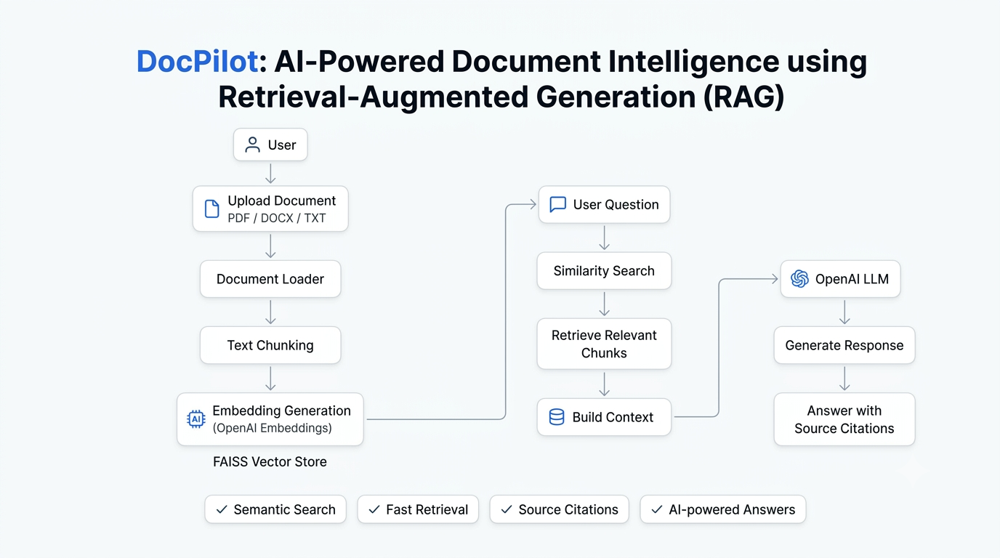
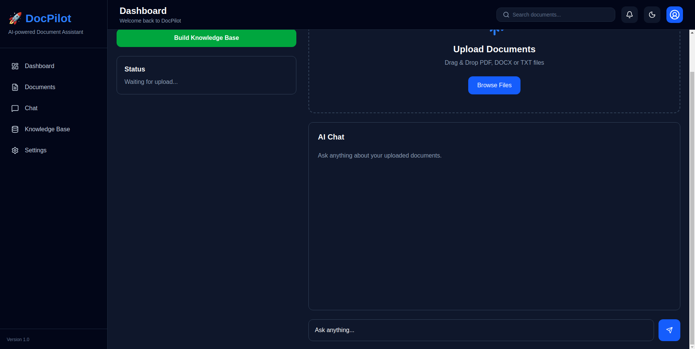
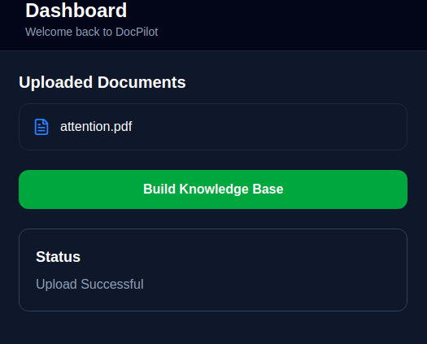
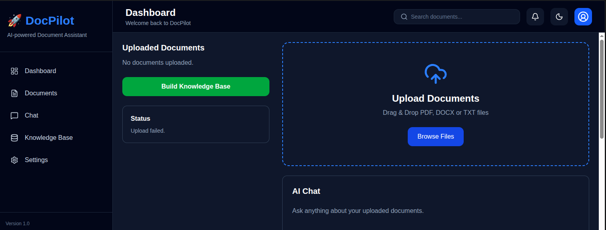
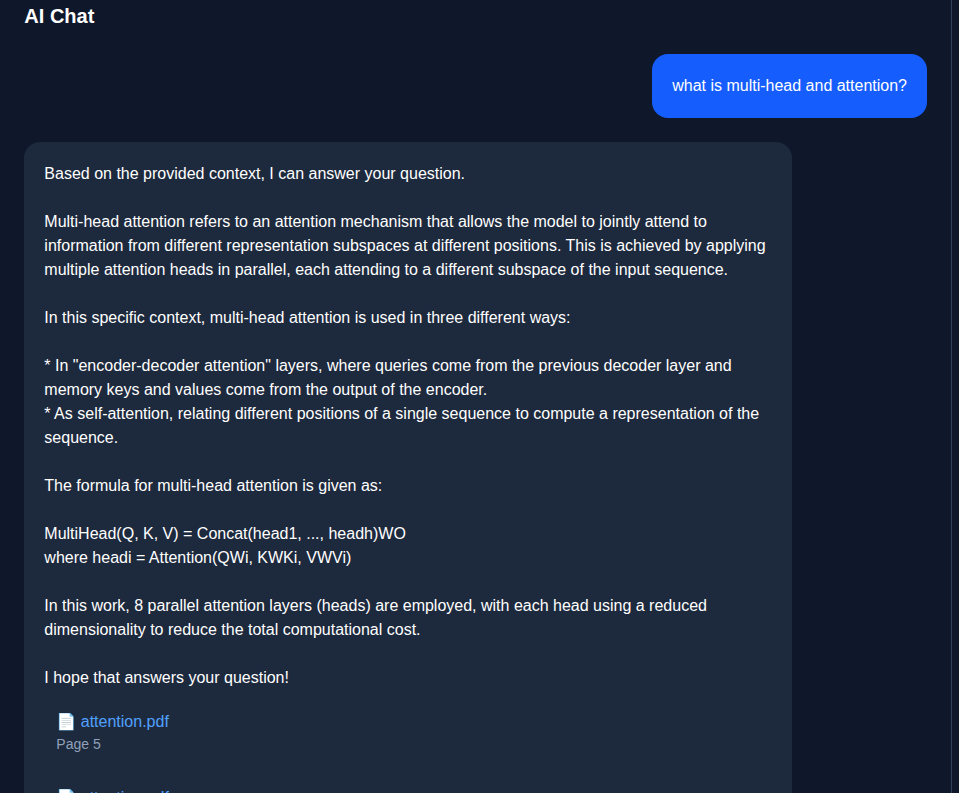

# DocPilot

**Local AI-powered document question answering with Retrieval-Augmented Generation (RAG).**

DocPilot lets you upload PDF, DOCX, and TXT documents, index their contents in FAISS, and ask questions through a React interface. The backend uses **Ollama** for local chat generation and **Hugging Face Sentence Transformers** for embeddings. An OpenAI API key is **not required** by the current chat implementation.

> This is a development project. Do not upload sensitive documents to a publicly exposed instance without adding appropriate authentication, access controls, and file-handling safeguards.

## Features

- PDF, DOCX, and TXT upload
- Multi-document FAISS indexing and semantic retrieval
- Answers accompanied by retrieved document metadata
- Local Ollama-powered question answering
- FastAPI backend and React + TypeScript + Vite frontend

## Architecture



1. Upload documents using the UI or `POST /upload`.
2. Build/rebuild the FAISS index with `POST /index`.
3. Ask questions using `POST /chat`. The backend retrieves relevant chunks and sends the resulting context to Ollama.
4. Receive an answer and source metadata.

The index is rebuilt from supported files in the upload folder; uploading alone does not automatically reindex.

## Application preview

**Dashboard**



**Document upload**



**Uploaded documents**



**Chat**



## Requirements

- Python and a working pip environment (a recent Python 3 version compatible with the pinned requirements)
- Node.js and npm compatible with the Vite version in `frontend/package.json`
- [Ollama](https://ollama.com/) installed and running locally
- Internet access for the initial embedding-model download

The pinned `requirements.txt` includes PyTorch and CUDA-related packages and may be large or platform-specific. It has not been verified here as a clean cross-platform installation. Use a supported Python environment and check dependency compatibility before deployment.

## Backend setup

Clone the repository and create a virtual environment from the **repository root**:

```bash
git clone https://github.com/Anziya25/docpilot.git
cd docpilot
python -m venv .venv
```

Activate the environment:

**Linux / macOS**

```bash
source .venv/bin/activate
```

**Windows PowerShell**

```powershell
.venv\Scripts\Activate.ps1
```

Install dependencies:

```bash
python -m pip install -r requirements.txt
```

Copy the example configuration to `.env` (Windows PowerShell: `Copy-Item .env.example .env`; Linux/macOS: `cp .env.example .env`). Adjust settings as needed:

```dotenv
UPLOAD_FOLDER=uploads
VECTOR_STORE_PATH=vector_store
EMBEDDING_MODEL=BAAI/bge-base-en-v1.5
CHUNK_SIZE=400
CHUNK_OVERLAP=80
LLM_MODEL=llama3.2:3b
HOST=127.0.0.1
PORT=8000
```

The `LLM_MODEL` value must match a model installed in Ollama. `HOST` and `PORT` are configuration examples; the Uvicorn command below explicitly sets its host and port.

In another terminal, start Ollama and download the example chat model:

```bash
ollama serve
```

```bash
ollama pull llama3.2:3b
```

If Ollama is already running as a service, do not start a second server. Use `ollama list` to verify that the configured model is installed.

Start the API **from the repository root**:

```bash
python -m uvicorn app.main:app --reload --host 127.0.0.1 --port 8000
```

Visit [http://127.0.0.1:8000/docs](http://127.0.0.1:8000/docs) for the interactive API documentation. `GET /health` is a basic status endpoint; it does not prove Ollama or the index is ready.

## Frontend setup

Open a separate terminal:

```bash
cd frontend
npm ci
npm run dev
```

Open the local address printed by Vite (normally [http://localhost:5173](http://localhost:5173)). The backend currently permits the localhost and 127.0.0.1 Vite development origins on port 5173.

## API endpoints

| Method | Endpoint | Purpose |
| --- | --- | --- |
| GET | `/` | API welcome message |
| GET | `/health` | Basic health status |
| POST | `/upload` | Upload a PDF, DOCX, or TXT file (multipart field `file`) |
| POST | `/index` | Build a FAISS index from uploaded files |
| POST | `/chat` | Ask a question using the indexed documents |

Upload and index documents before chatting. The embedding model is downloaded on first use if it is not cached.

## Tests and frontend checks

From the repository root with backend dependencies installed:

```bash
python -m pip install pytest
python -m pytest tests/ -v
```

Some tests may require local models, files, or additional services. This command is a suggested verification step, **not** a claim that all tests currently pass.

From `frontend/`:

```bash
npm ci
npm run lint
npm run build
```

These checks have not been run as part of this documentation update.

## Project structure

```text
docpilot/
├── app/
│   ├── api/
│   ├── config/
│   ├── core/
│   ├── database/
│   ├── models/
│   ├── services/
│   ├── utils/
│   └── main.py
├── documents/
│   └── notes/
├── frontend/
├── screenshots/
├── tests/
├── .env.example
├── .gitignore
├── requirements.txt
└── README.md
```

Runtime upload files and FAISS indexes are excluded by `.gitignore`. Do not commit private source documents, credentials, or generated indexes.

## Limitations

- The current backend uses Ollama, not the OpenAI API, for answer generation.
- A FAISS index must exist before retrieval can work.
- Source metadata is returned, but it is not a guarantee of factual correctness or citation quality.
- The current upload route should be hardened for untrusted/public use (for example, filename sanitization, file-size limits, authentication, and validation).
- Local FAISS loading uses pickle-based deserialization. Only load indexes created by a trusted process; never load untrusted index files.
- No production deployment, comprehensive security review, or clean-install test is claimed here.

## License

MIT License — see [LICENSE](LICENSE).
